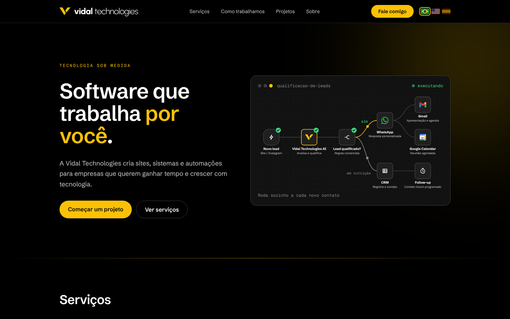
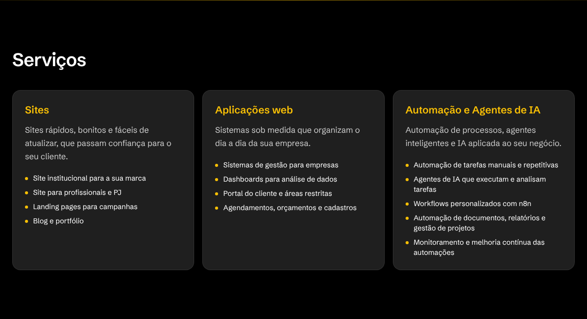
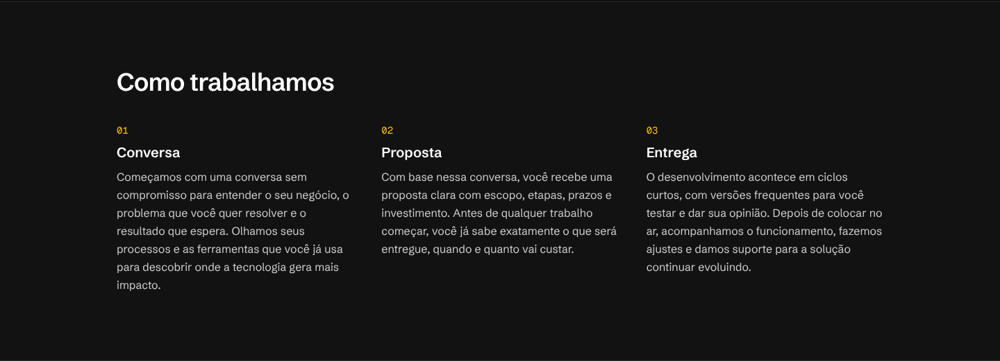
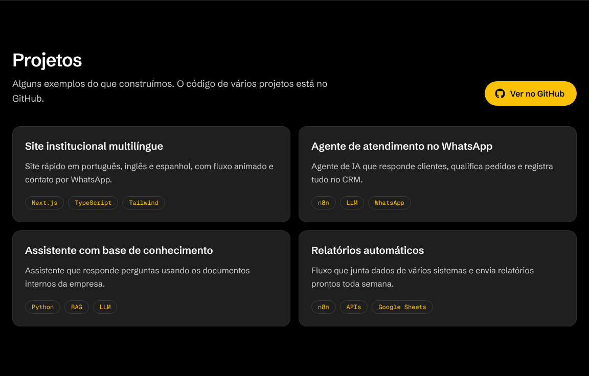
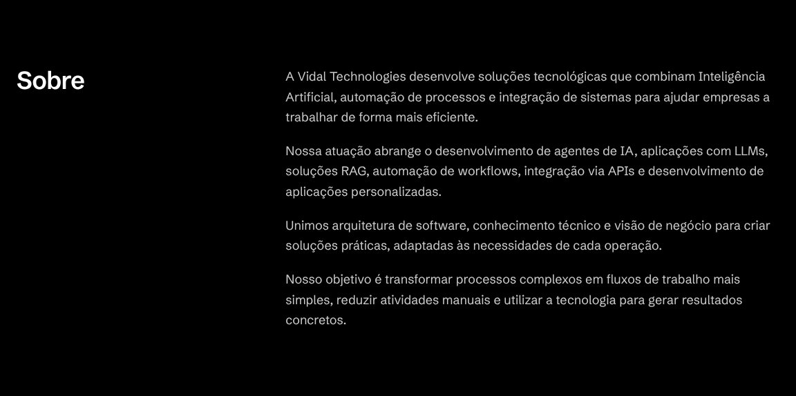
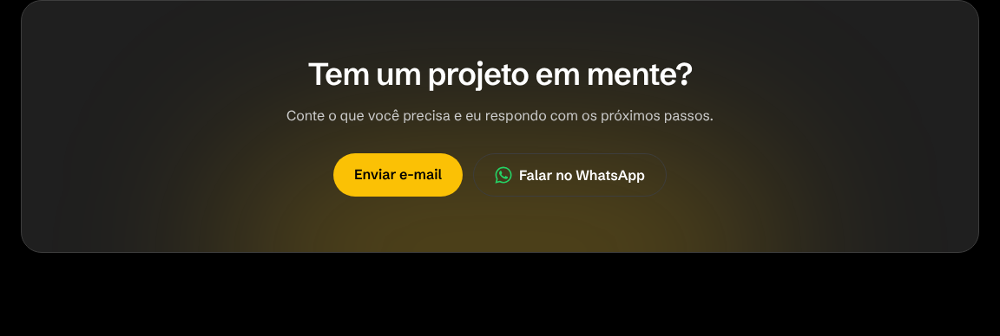
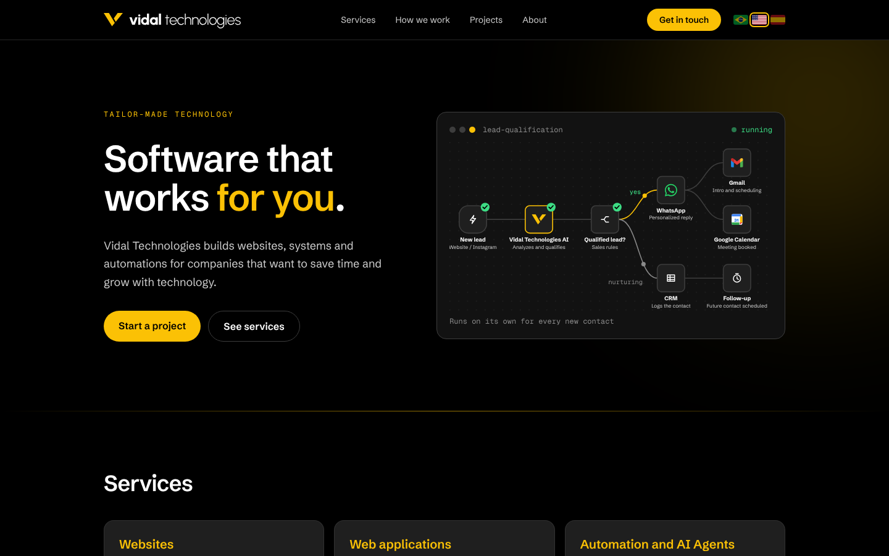
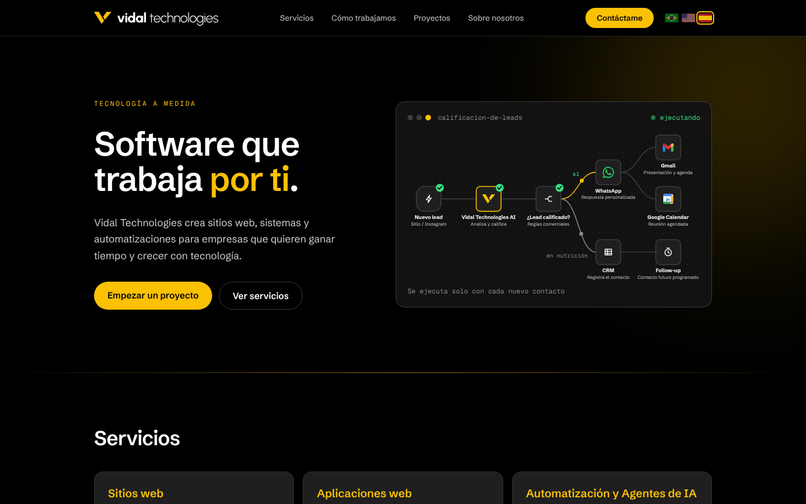
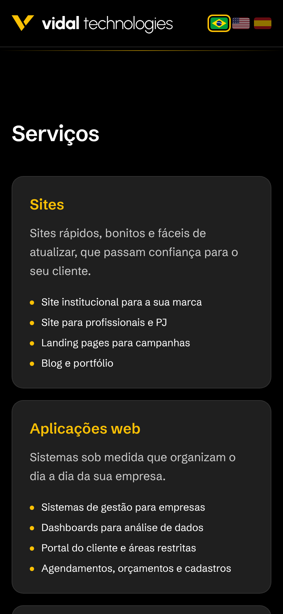
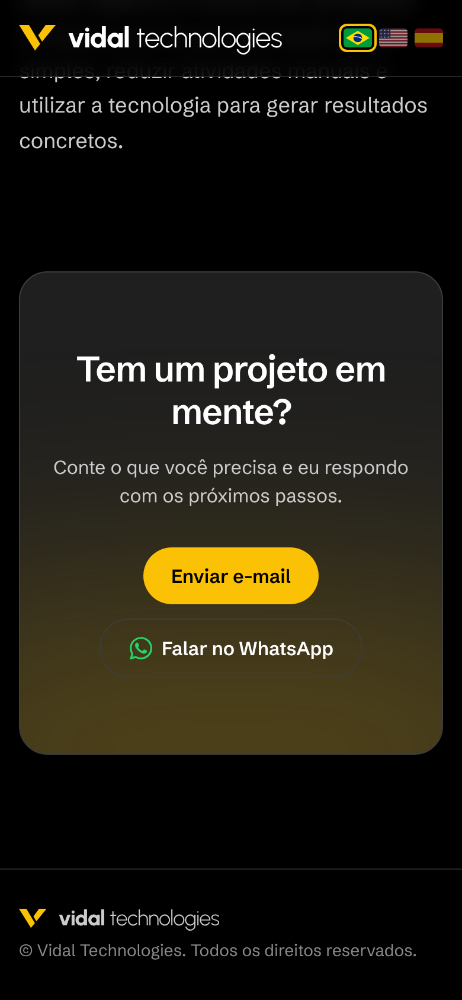

<p align="center">
  
</p>

<h1 align="center">Vidal Technologies — site institucional</h1>

<p align="center">
  Site da <strong>Vidal Technologies</strong>, empresa que cria sites, sistemas e automações com IA para empresas.<br />
  Disponível em português, inglês e espanhol.
</p>

<p align="center">
  <strong>Português</strong> · <a href="README.en.md">English</a> · <a href="README.es.md">Español</a>
</p>

<p align="center">
  
  
  
  
  
</p>



## Sobre o projeto

Este repositório contém o site institucional da Vidal Technologies. O objetivo é
apresentar a empresa e os seus serviços de forma clara e visual, mostrar exemplos de
projetos e facilitar o primeiro contato de quem quer começar um projeto, por e-mail
ou WhatsApp.

O site também funciona como peça de portfólio: o código é aberto para quem quiser ver
como ele foi construído.

### Objetivos

- Apresentar a empresa e os serviços em uma página única, rápida e fácil de navegar.
- Mostrar, de forma visual, o tipo de automação que a empresa entrega.
- Atender clientes no Brasil e no exterior, com o conteúdo em três idiomas.
- Levar o visitante ao contato com poucos cliques.

## Funcionalidades

- **Três idiomas:** português (`/`), inglês (`/en`) e espanhol (`/es`), com troca por
  bandeiras no canto superior direito. Todos os textos ficam em um único arquivo.
- **Fluxo de automação animado:** ao lado do título, um fluxo no estilo n8n mostra um
  lead sendo qualificado por IA e seguindo para WhatsApp, Gmail, Google Calendar ou CRM.
  No celular, o fluxo vira uma versão vertical.
- **Serviços:** Sites, Aplicações web e Automação e Agentes de IA, cada um com exemplos.
- **Como trabalhamos:** as etapas Conversa, Proposta e Entrega.
- **Projetos:** cards com exemplos de projetos e um botão que leva ao GitHub.
- **Sobre:** a apresentação da empresa.
- **Contato:** botões para enviar e-mail e falar no WhatsApp.
- **Responsivo:** layout pensado para computador e celular.
- **Identidade visual própria:** fundo preto, tons de grafite e dourado `#FBC105`,
  fonte Schibsted Grotesk e logo desenhada em SVG.

## Telas

### Computador

| Serviços | Como trabalhamos |
| --- | --- |
|  |  |

| Projetos | Sobre |
| --- | --- |
|  |  |

| Contato | |
| --- | --- |
|  | |

### Outros idiomas

| Inglês (`/en`) | Espanhol (`/es`) |
| --- | --- |
|  |  |

### Celular

| Início | Serviços | Contato |
| --- | --- | --- |
|  |  |  |

## Tecnologias

| Tecnologia | Para que serve |
| --- | --- |
| [Next.js](https://nextjs.org/) (App Router) | Estrutura do site, rotas por idioma e geração das páginas estáticas |
| [React](https://react.dev/) | Componentes da interface |
| [TypeScript](https://www.typescriptlang.org/) | Código com tipagem, mais seguro de manter |
| [Tailwind CSS](https://tailwindcss.com/) | Estilos e layout responsivo |
| SVG e CSS | Logo, ícones e animação do fluxo de automação |

O site não usa banco de dados nem login. Todas as páginas são geradas como arquivos
estáticos (HTML, CSS e JavaScript), o que deixa o site rápido, barato de hospedar e
sem servidor para manter.

## Como rodar no seu computador

Você vai precisar do [Node.js](https://nodejs.org/) 20 ou mais recente.

```bash
git clone https://github.com/vidaltechnologies/vidaltechnologies-site.git
cd vidaltechnologies-site
npm install
npm run dev
```

Depois, abra http://localhost:3000. As versões em inglês e espanhol ficam em
http://localhost:3000/en e http://localhost:3000/es.

Outros comandos:

| Comando | O que faz |
| --- | --- |
| `npm run build` | Gera a versão final do site |
| `npm run start` | Roda a versão final gerada pelo `build` |
| `npm run lint` | Verifica o código |

## Estrutura do código

```
src/
├── app/
│   ├── page.tsx            # Página inicial em português
│   ├── [lang]/page.tsx     # Páginas em inglês e espanhol
│   ├── layout.tsx          # Estrutura comum, fontes e metadados
│   ├── globals.css         # Cores e estilos globais
│   └── icon.svg            # Ícone da aba do navegador
├── components/
│   ├── home.tsx            # Seções da página
│   ├── automation-flow.tsx # Fluxo de automação animado
│   ├── language-switcher.tsx
│   ├── logo.tsx
│   └── whatsapp-icon.tsx
└── i18n/
    └── dictionaries.ts     # Todos os textos, nos três idiomas
docs/
└── screenshots/            # Imagens usadas neste README
```

---

© Vidal Technologies. Todos os direitos reservados.
